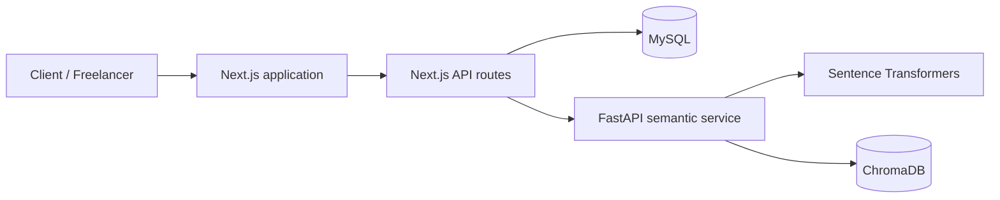

# Gigsy

<p align="center">
  <strong>AI-powered freelance marketplace</strong><br/>
  Discover talent, publish work, submit proposals, and manage contracts with semantic skill matching.
</p>

<p align="center">
  
  
  
  
  
  
</p>

Gigsy is a two-sided marketplace built around two roles:

- **Clients** publish gigs, review applications, hire freelancers, and manage project milestones.
- **Freelancers** discover opportunities, submit proposals, manage contracts, and track their work.

Gig discovery is enhanced with local semantic search: natural-language queries are embedded using Sentence Transformers and matched against gig vectors stored in ChromaDB. MySQL remains the source of truth for marketplace and transactional data.

---

## Contents

- [Features](#features)
- [Technology stack](#technology-stack)
- [Architecture](#architecture)
- [Repository layout](#repository-layout)
- [Getting started](#getting-started)
- [Environment configuration](#environment-configuration)
- [Database setup](#database-setup)
- [Run Gigsy locally](#run-gigsy-locally)
- [Semantic search setup](#semantic-search-setup)
- [Useful endpoints](#useful-endpoints)
- [Development checks](#development-checks)
- [Documentation](#documentation)
- [Contributing](#contributing)
- [Security](#security)

## Features

### Marketplace
- Separate Client and Freelancer experiences.
- Create and browse gig listings.
- Freelancer proposals and Client applicant management.
- Freelancer talent directory and profile pages.

### AI-powered discovery
- Natural-language gig search.
- Sentence Transformers embeddings using `all-MiniLM-L6-v2`.
- ChromaDB vector similarity search.
- MySQL validation of returned gig records and their current status.

### Hiring and project management
- Transactional proposal acceptance.
- Contract creation and a three-stage milestone plan.
- Notifications for hiring and proposal outcomes.
- Freelancer milestone submission and Client milestone approval.
- Contract and gig completion when all milestones are approved.

### Collaboration
- Role-aware dashboards and navigation.
- Messaging endpoints and workspace.
- GitHub Actions TypeScript check on pushes and pull requests.

## Technology stack

| Layer | Technology | Responsibility |
|---|---|---|
| Web application | Next.js 15, React 19, TypeScript | Pages, UI and server-side API routes |
| Styling | CSS | Application styling and responsive presentation |
| Relational database | MySQL | Users, gigs, proposals, contracts, milestones and messages |
| Database driver | mysql2 | MySQL connectivity |
| Semantic API | FastAPI | Embedding and vector-search endpoints |
| Embeddings | Sentence Transformers | Local text embeddings |
| Vector database | ChromaDB | Gig vector storage and similarity search |
| CI | GitHub Actions | TypeScript static check |

## Architecture



**Data ownership:** MySQL stores authoritative marketplace and workflow records. ChromaDB stores searchable vector representations; it does not replace MySQL.

## Repository layout

```text
Gigsy/
├── .github/
│   ├── ISSUE_TEMPLATE/
│   ├── workflows/
│   └── pull_request_template.md
├── database/
│   ├── gigsy_hiring_workflow.sql
│   └── messaging.sql
├── docs/
│   ├── architecture.md
│   ├── backend-and-api.md
│   ├── hiring-workflow.md
│   ├── semantic-search.md
│   └── windows-setup.md
├── semantic_service/
│   ├── app/
│   │   └── main.py
│   ├── requirements.txt
│   ├── .env.example
│   └── README.md
├── src/
│   ├── app/
│   │   ├── api/
│   │   └── ... application pages
│   ├── components/
│   └── lib/
├── .env.example
├── CONTRIBUTING.md
├── package.json
├── apply-hiring-migration.ps1
├── setup-gigsy.ps1
├── start-all.ps1
├── start-gigsy.ps1
├── start-semantic.ps1
└── README.md
```

PowerShell scripts remain in the repository root so their relative paths and Windows launch workflow continue to work.

## Getting started

### Prerequisites

- Node.js 22 LTS (recommended for this repository's CI setup).
- MySQL Server with the existing Gigsy database.
- Python 3.11 or 3.13 (64-bit) and the Windows `py` launcher.
- Internet access for package installation and the first Sentence Transformers model download.

### 1. Clone the repository

```powershell
git clone https://github.com/vikaskulakarni/Gigsy.git
cd Gigsy
```

### 2. Install Node dependencies

```powershell
npm ci
```

### 3. Configure environment variables

Copy the example file and fill in your local values:

```powershell
Copy-Item .env.example .env.local
```

See [Environment configuration](#environment-configuration). Do not commit `.env.local`.

### 4. Configure the semantic service

Follow [docs/semantic-search.md](docs/semantic-search.md) to create the Python virtual environment, install requirements, and configure the service token.

### 5. Apply the hiring workflow migration

If your database has not already had this additive migration applied, run:

```powershell
.\apply-hiring-migration.ps1
```

See [docs/hiring-workflow.md](docs/hiring-workflow.md) before applying database changes.

### 6. Start the application

Open separate PowerShell terminals:

**Terminal 1 — semantic service**
```powershell
.\start-semantic.ps1
```

**Terminal 2 — Next.js**
```powershell
.\start-gigsy.ps1
```

Open [http://localhost:3000](http://localhost:3000).

For guided Windows setup, see [docs/windows-setup.md](docs/windows-setup.md). The `RUN_GIGSY.ps1` launcher can also coordinate setup and service startup.

## Environment configuration

The root `.env.example` documents the Next.js environment:

| Variable | Purpose |
|---|---|
| `DB_HOST`, `DB_PORT` | MySQL host and port |
| `DB_USER`, `DB_PASSWORD` | MySQL credentials |
| `DB_NAME` | Database name (normally `gigsy`) |
| `SESSION_SECRET` | Session signing secret |
| `CHROMA_SERVICE_URL` | Base URL of the FastAPI semantic service |
| `CHROMA_SERVICE_TOKEN` | Shared service authentication token |
| `INDEXING_SECRET` | Protects the gig indexing endpoint |

The semantic service has its own `semantic_service/.env.example`. Its `CHROMA_SERVICE_TOKEN` must match the value configured in the root `.env.local`.

Generate strong random secrets locally. Never use the example placeholder values in a deployed environment.

## Database setup

Gigsy uses MySQL for persistent marketplace records. The repository includes additive SQL scripts under `database/`.

- `gigsy_hiring_workflow.sql` adds contract, milestone and notification tables.
- `messaging.sql` contains messaging-related database setup.

Do not recreate an existing database or run destructive SQL to get started. Review each migration and back up important data before applying schema changes.

## Run Gigsy locally

| Service | Local address |
|---|---|
| Next.js application | http://localhost:3000 |
| MySQL health through Next.js | http://localhost:3000/api/health |
| FastAPI / ChromaDB health | http://localhost:8001/health |

Keep both the Next.js and semantic-service terminals running during local development.

## Semantic search setup

Gigsy uses a local Sentence Transformers model and ChromaDB. The first run downloads the embedding model; subsequent embedding and vector search operations run locally.

See the complete [Semantic search setup guide](docs/semantic-search.md) for Windows commands, token configuration, indexing and troubleshooting.

## Useful endpoints

| Endpoint | Purpose |
|---|---|
| `GET /api/health` | Check Next.js-to-MySQL connectivity |
| `GET /api/auth/me` | Read the current session |
| `GET /api/dashboard` | Dashboard data |
| `GET /api/gigs` | Browse gigs |
| `GET/POST/PATCH /api/proposals` | Proposal workflows |
| `GET /api/contracts` | Contracts for the current account |
| `GET/PATCH /api/contracts/:id` | Contract and milestone workflow |
| `GET/PATCH /api/notifications` | User notifications |
| `GET /health` (FastAPI) | Semantic service health |

Authenticated routes require the appropriate session and role.

## Development checks

Install dependencies, then run:

```powershell
npx tsc --noEmit
npm run build
```

GitHub Actions runs the TypeScript check on pushes and pull requests targeting `main`. A passing typecheck is not a substitute for testing MySQL migrations, authentication, semantic search, and Client/Freelancer workflows locally.

## Documentation

- [Windows setup](docs/windows-setup.md)
- [Architecture overview](docs/architecture.md)
- [Backend and API guide](docs/backend-and-api.md)
- [Hiring workflow and migration](docs/hiring-workflow.md)
- [Semantic search setup](docs/semantic-search.md)
- [Contribution guide](CONTRIBUTING.md)

## Contributing

Contributions are welcome. Please read [CONTRIBUTING.md](CONTRIBUTING.md), create a focused feature or fix branch, and open a pull request against `main`. Include the behavior changed, verification performed, screenshots for UI changes, and any database or environment changes.

## Security

- Never commit `.env.local`, `semantic_service/.env`, passwords, tokens, database dumps, or local ChromaDB data.
- Keep service tokens server-side; do not expose them to browser code.
- Report security issues privately to the repository owner rather than publishing credentials or exploit details in an issue.
