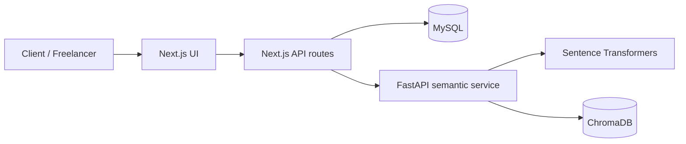

# Gigsy architecture

## System overview

Gigsy is a Next.js marketplace with MySQL as its relational source of truth and a separate FastAPI service for semantic gig discovery.

## Responsibilities

| Component | Responsibility |
|---|---|
| `src/app` | Next.js routes, pages and API endpoints |
| `src/components` | Reusable UI and role-specific workspaces |
| `src/lib` | Shared authentication, database and data helpers |
| `database` | SQL migrations and schema additions |
| `semantic_service/app` | FastAPI endpoints for embedding, indexing and similarity search |
| `.github/workflows` | Continuous integration |

## Data ownership

- MySQL stores accounts, gigs, proposals, contracts, milestones, notifications and messaging records.
- ChromaDB stores vector representations used to retrieve semantically similar gigs.
- Search results should be validated against MySQL before being presented as current marketplace records.

## Main request flows

### Marketplace request

1. A user interacts with a Next.js page.
2. The page calls a same-origin Next.js API route.
3. The route authenticates the user and applies role/ownership checks.
4. The route reads or writes MySQL data.

### Semantic matching

1. The Next.js API sends a search or indexing request to FastAPI.
2. FastAPI uses Sentence Transformers to generate embeddings.
3. ChromaDB stores or retrieves vectors.
4. The application uses returned gig identifiers to resolve authoritative gig data from MySQL.

### Hiring

Proposal acceptance is handled as a MySQL transaction. The workflow creates a contract, initial milestones and notifications while updating proposal and gig status. See [hiring-workflow.md](./hiring-workflow.md).

## Local services

- Next.js: `http://localhost:3000`
- MySQL: configured through the root `.env.local`
- FastAPI: `http://127.0.0.1:8001`
- ChromaDB: persistent local collection configured by the semantic service environment.

This document describes the current repository organization and documented application responsibilities; it is not a substitute for runtime or security testing.
